# Demo — how php2shell_audit works and what it shows

PHP2Shell (`CVE-2026-109618`, `CVE-2026-109619`) is a critical, unauthenticated
PHP engine RCE. This tool detects **exposure** — from the PHP version and
configuration — in code and over the network. It is non-intrusive: it never
sends an exploit payload. The runs below use the bundled mock lab (no real PHP,
nothing exploitable), so anyone can reproduce them in two minutes.



*(Animated — loops; shows both demos. If it isn't moving, your viewer may not animate SVG; the captured text is below.)*

---

## Demo 1 — scanning CODE (a repository)

Walks a repo for pinned PHP runtimes (Dockerfile, composer.json, CI,
`.php-version`) and risky `php.ini`/FPM settings. Fully offline.

```console
$ python3 php2shell_audit.py codebase tests/fixtures

======================================================================
 PHP2Shell scan  (CVE-2026-109618, CVE-2026-109619)
 mode=codebase  target=tests/fixtures
======================================================================
 Summary: CRITICAL:1  HIGH:0  MEDIUM:4  LOW:3  INFO:1

[CRIT] Pinned PHP runtime (Dockerfile base image 'php:8.3.12-apache')
       target : tests/fixtures/Dockerfile
       version: 8.3.12  (VULNERABLE)
       detail : PHP 8.3.12 is below the fixed release 8.3.36.
       evidence: php:8.3.12-apache
       fix    : Upgrade to the fixed release for your branch (8.2.35 / 8.3.36 / 8.4.27 / 8.5.12) and RESTART every PHP worker (FPM pool, Apache, etc.) — the running process keeps the old code until restarted.

[MED ] mod_php (Apache) base image
       target : tests/fixtures/Dockerfile
       detail : Apache mod_php is the highest-risk SAPI for PHP2Shell.
       evidence: php:8.3.12-apache
       fix    : mod_php (Apache prefork) is rated the highest-risk SAPI for PHP2Shell. Prioritise patching these hosts; consider PHP-FPM.

[MED ] Pinned PHP runtime (composer.json php constraint '>=8.2')
       target : tests/fixtures/composer.json
       version: 8.2  (BRANCH_AFFECTED_PATCH_UNKNOWN)
       detail : PHP 8.2 is an affected branch, but the patch level is unknown. Vulnerable below 8.2.35; confirm the exact build serving requests.
       evidence: >=8.2
       fix    : Confirm the exact PHP build serving web requests (phpinfo / package manager), then Upgrade to the fixed release for your branch (8.2.35 / 8.3.36 / 8.4.27 / 8.5.12) and RESTART every PHP worker (FPM pool, Apache, etc.) — the running process keeps the old code until restarted.

[MED ] Pinned PHP runtime (CI php-version '8.4')
       target : tests/fixtures/.github/workflows/ci.yml
       version: 8.4  (BRANCH_AFFECTED_PATCH_UNKNOWN)
       detail : PHP 8.4 is an affected branch, but the patch level is unknown. Vulnerable below 8.4.27; confirm the exact build serving requests.
       evidence: 8.4
       fix    : Confirm the exact PHP build serving web requests (phpinfo / package manager), then Upgrade to the fixed release for your branch (8.2.35 / 8.3.36 / 8.4.27 / 8.5.12) and RESTART every PHP worker (FPM pool, Apache, etc.) — the running process keeps the old code until restarted.

[MED ] session.upload_progress enabled
       target : tests/fixtures/conf/php.ini
       detail : session.upload_progress.enabled is On — a confirmed CVE-2026-109619 path.
       evidence: session.upload_progress.enabled = On
       fix    : Set session.upload_progress.enabled=0 in php.ini / the FPM pool / server config (NOT via ini_set() or .user.ini) and restart workers. This closes one confirmed path for CVE-2026-109619 but is not a complete mitigation on its own — patching is.

[LOW ] fatal_error_backtraces enabled (PHP 8.5)
       target : tests/fixtures/conf/php.ini
       detail : A confirmed mod_php path on PHP 8.5.
       evidence: fatal_error_backtraces = On
       fix    : On PHP 8.5, set fatal_error_backtraces=0 administratively and restart workers — a confirmed mod_php path.

[LOW ] Unbounded memory_limit
       target : tests/fixtures/conf/php.ini
       detail : memory_limit=-1 removes the per-request cap and raises resource-exhaustion risk.
       evidence: memory_limit = -1
       fix    : Constrain request size/complexity at the proxy and in PHP (post_max_size, upload_max_filesize, max_input_nesting_level, max_file_uploads). These reduce exploitability but do not replace patching.

[LOW ] Large post_max_size
       target : tests/fixtures/conf/php.ini
       detail : post_max_size=128M widens the multipart attack surface for CVE-2026-109618.
       evidence: post_max_size = 128M
       fix    : Constrain request size/complexity at the proxy and in PHP (post_max_size, upload_max_filesize, max_input_nesting_level, max_file_uploads). These reduce exploitability but do not replace patching.

[INFO] Pinned PHP runtime (.php-version pin)
       target : tests/fixtures/.php-version
       version: 8.3.36  (FIXED)
       detail : PHP 8.3.36 is at or above the fixed release 8.3.36. (Note: distro backports may keep an older number — verify the package changelog.)
       evidence: 8.3.36
       fix    : No action for the engine version; keep workers restarted after the upgrade and verify config hardening.

----------------------------------------------------------------------
 NOTE: Version/config detection is non-intrusive and does not prove
       exploitability by exploiting. A hidden version is not an all-clear.
 AUTHORIZED USE ONLY — scan only systems you own or are explicitly permitted to assess.
----------------------------------------------------------------------
```

What it caught: a vulnerable `php:8.3.12-apache` base image (CRITICAL), the
higher-risk mod_php SAPI, `session.upload_progress` left on, a branch pin whose
exact patch is unknown, and a correctly-cleared fixed `.php-version` (INFO).

---

## Demo 2 — scanning a URL (a live host)

Non-intrusive: one plain GET, reads `Server` / `X-Powered-By` (and an optional
phpinfo page), compares to the fixed releases. `fleet` does the same over a
list. (Network modes require `--authorized`.)

```console

======================================================================
 PHP2Shell scan  (CVE-2026-109618, CVE-2026-109619)
 mode=fleet  target=testlab/lab_hosts.txt
======================================================================
 Summary: CRITICAL:1  HIGH:1  MEDIUM:0  LOW:1  INFO:1

[CRIT] Live PHP version via x-powered-by
       target : 127.0.0.1:8801
       version: 8.3.12  (VULNERABLE)
       detail : PHP 8.3.12 is below the fixed release 8.3.36.
       evidence: x-powered-by: PHP/8.3.12
       fix    : Upgrade to the fixed release for your branch (8.2.35 / 8.3.36 / 8.4.27 / 8.5.12) and RESTART every PHP worker (FPM pool, Apache, etc.) — the running process keeps the old code until restarted.

[HIGH] Live PHP version via x-powered-by
       target : 127.0.0.1:8802
       version: 8.1.20  (VULNERABLE_NO_UPSTREAM_FIX)
       detail : PHP 8.1 is affected and has no mainline fix; a distro backport or upgrade is required.
       evidence: x-powered-by: PHP/8.1.20
       fix    : No mainline PHP fix exists for this branch. Use your distribution's backported package (e.g. RHEL/Debian security update) or PHP's minimal source backport, then restart workers. Verify the package changelog references the CVEs — the version number may not change.

[LOW ] PHP version not disclosed
       target : 127.0.0.1:8804
       detail : No PHP version in Server/X-Powered-By headers. The server may hide it (good practice) — this is NOT an all-clear. Confirm the version via authenticated inventory / package manager.
       evidence: server: nginx

[INFO] Live PHP version via x-powered-by
       target : 127.0.0.1:8803
       version: 8.3.36  (FIXED)
       detail : PHP 8.3.36 is at or above the fixed release 8.3.36. (Note: distro backports may keep an older number — verify the package changelog.)
       evidence: x-powered-by: PHP/8.3.36
       fix    : No action for the engine version; keep workers restarted after the upgrade and verify config hardening.

----------------------------------------------------------------------
 NOTE: Version/config detection is non-intrusive and does not prove
       exploitability by exploiting. A hidden version is not an all-clear.
 AUTHORIZED USE ONLY — scan only systems you own or are explicitly permitted to assess.
----------------------------------------------------------------------
```

| Target | Advertises | Verdict |
|--------|------------|---------|
| :8801  | PHP 8.3.12 (mod_php) | **CRITICAL** — below 8.3.36 |
| :8802  | PHP 8.1.20 | **HIGH** — affected branch, no upstream fix |
| :8803  | PHP 8.3.36 | **INFO** — fixed |
| :8804  | (version hidden) | **LOW** — not disclosed (not an all-clear) |

---

## Machine-readable output

Add `--json` for pipelines/SIEM. One finding:

```json
{
  "severity": "CRITICAL",
  "title": "Live PHP version via x-powered-by",
  "target": "127.0.0.1:8801",
  "detail": "PHP 8.3.12 is below the fixed release 8.3.36.",
  "evidence": "x-powered-by: PHP/8.3.12",
  "php_version": "8.3.12",
  "verdict": "VULNERABLE",
  "remediation": [
    "Upgrade to the fixed release for your branch (8.2.35 / 8.3.36 / 8.4.27 / 8.5.12) and RESTART every PHP worker (FPM pool, Apache, etc.) \u2014 the running process keeps the old code until restarted."
  ],
  "cves": [
    "CVE-2026-109618",
    "CVE-2026-109619"
  ]
}
```

---

## Reproduce it yourself

```bash
# Code demo
python3 php2shell_audit.py codebase tests/fixtures

# URL demo — terminal 1 starts the mock lab, terminal 2 scans it
python3 testlab/mock_vuln_target.py --lab
python3 php2shell_audit.py fleet testlab/lab_hosts.txt --authorized
```

Exit codes make it CI-ready: `0` clean, `1` low/med, `2` high/crit, `3` refused.

> Note: these demos prove the scanner *identifies* vulnerable versions, which
> is what a detector is for. They intentionally do not show exploitation.
